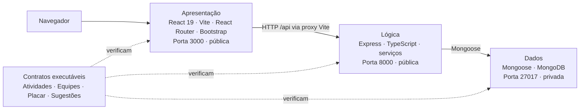

# Arquitetura do OctoFit Tracker

O OctoFit Tracker é uma aplicação de três camadas para um programa de atividades físicas escolar. O código inicial inclui contratos de API e pontos de implementação intencionalmente incompletos para que você use o modo agent do GitHub Copilot em um ciclo guiado por testes.

## Limites entre as camadas

- **Camada de apresentação**: React 19, Vite, React Router, Bootstrap e um cliente compartilhado da API em `octofit-tracker/frontend/src`.
- **Camada de lógica**: rotas e serviços Express com TypeScript em `octofit-tracker/backend/src` expõem o comportamento `/api/*` na porta `8000`.
- **Camada de dados**: modelos Mongoose e dados de demonstração em `octofit-tracker/backend/src/models` e `src/scripts/seed.ts` são persistidos no MongoDB na porta `27017`.

## Portas e regras de ambiente

- MongoDB: `27017` (privada)
- API Express: `8000` (pública)
- Interface Vite: `3000` (pública)
- O navegador acessa caminhos relativos `/api`. O Vite os encaminha para `http://localhost:8000`; `VITE_API_BASE_URL` pode substituir a URL-base.
- Não encaminhe nem torne públicas outras portas.

## Contrato da API

| Capacidade | Método e caminho | Comportamento esperado |
| --- | --- | --- |
| Registro de atividades | `GET /api/activities`, `POST /api/activities` | Lista e cria atividades válidas. POST recebe `userId`, `teamId`, `type` e `minutes`; `userId` e `teamId` devem ser IDs bem-formados de uma pessoa e uma equipe existentes, caso contrário a API retorna um 4xx intencional (nunca um 500 causado por erro de conversão). Uma atividade criada armazena `user`, `team`, `type` e `minutes` enviados, além de `points` e `occurredAt` calculados. |
| Equipes | `GET /api/teams`, `POST /api/teams` | Lista e cria equipes com integrantes. As equipes criadas e listadas mantêm os valores enviados em `name` e `mascot`. Rejeita uma equipe sem nome com `400`. |
| Placar | `GET /api/leaderboard` | Retorna as equipes ordenadas pela soma dos pontos de suas atividades, da maior para a menor. Cada item contém `teamName`, `totalPoints` e uma `rank` iniciada em 1. |
| Sugestões de treino | `GET /api/workouts/suggestions/:userEmail` | Recomenda treinos com base nos padrões de atividade recentes da pessoa correspondente ao e-mail seed. O foco da primeira sugestão (`focus`) corresponde à meta ou à atividade recente dessa pessoa, e o campo `reason` explica o motivo. Um e-mail sem pessoa correspondente retorna um 4xx intencional (por exemplo, `404`). |

## Decisões de implementação

- Camada de apresentação: manter a interface em React e concentrar as chamadas HTTP no cliente compartilhado em `frontend/src/api`; cada página apresenta estados acessíveis de carregamento, vazio e erro.
- Camada de lógica: manter validação e regras de negócio nas rotas e serviços Express, retornando respostas JSON consistentes e erros 4xx intencionais para entradas ou referências inválidas.
- Camada de dados: usar os modelos Mongoose para validação e persistência; o seed deve criar dados representativos relacionados e poder ser executado novamente sem duplicar nem substituir dados não relacionados.
- Registro de atividades: validar formato e existência de `userId` e `teamId` antes da conversão/persistência; calcular `points` e `occurredAt` no backend e devolver as referências e os valores calculados.
- Gerenciamento de equipes: validar `name`, preservar `name` e `mascot` enviados e manter os integrantes associados pelos IDs de usuário.
- Placar: agregar os pontos das atividades por equipe, ordenar do maior para o menor e atribuir posições começando em 1.
- Sugestões de treino: localizar a pessoa pelo e-mail, usar sua meta ou atividade recente para priorizar o foco e incluir uma justificativa; retornar 4xx quando a pessoa não existir.

Implemente e valide nesta ordem: modelos/seed, serviços e rotas da API, depois cliente e páginas do frontend. Essa sequência testa cada camada antes que a seguinte dependa dela.

## Plano de testes

Execute os testes por camada na ordem abaixo. Os resultados registrados são a linha de base observada antes da implementação; uma falha aponta o contrato ainda não atendido naquela camada.

- Dados: `npm run test:data --prefix octofit-tracker/backend` — linha de base: 4 falhas e 1 aprovação; as falhas indicam validações incompletas nos modelos de pessoa, equipe, atividade e treino. O teste de seed passa.
- API: `npm run test:api --prefix octofit-tracker/backend` — linha de base: 4 falhas; atividades, equipes, placar e sugestões ainda não atendem aos contratos. A primeira requisição inválida recebe `501` em vez de `400`.
- Frontend: `npm test --prefix octofit-tracker/frontend` — linha de base: 15 falhas; três testes de exibição/consulta e, para cada rota, os estados de carregamento, vazio e erro não atendem ao contrato.
- Compilação do backend: `npm run build --prefix octofit-tracker/backend` — ainda não executada; confirmar a tipagem depois das mudanças na API e nos modelos.
- Compilação do frontend: `npm run build --prefix octofit-tracker/frontend` — ainda não executada; confirmar os tipos e o bundle depois das mudanças na apresentação.

## Decisões de implementação
 
Registre seu plano aqui antes de editar o código.
 
- Decisão da camada de apresentação:
- Decisão da camada de lógica:
- Decisão da camada de dados:
- Abordagem para registro de atividades:
- Abordagem para gerenciamento de equipes:
- Abordagem para o placar:
- Abordagem para sugestões de treino:
 
## Plano de testes
 
Registre os comandos executados e o significado de cada falha.
 
- Testes da camada de dados: npm run test:data --prefix octofit-tracker/backend
- Testes da API: npm run test:api --prefix octofit-tracker/backend
- Testes do frontend: npm test --prefix octofit-tracker/frontend
- Compilação do backend: npm run build --prefix octofit-tracker/backend
- Compilação do frontend: npm run build --prefix octofit-tracker/frontend
 